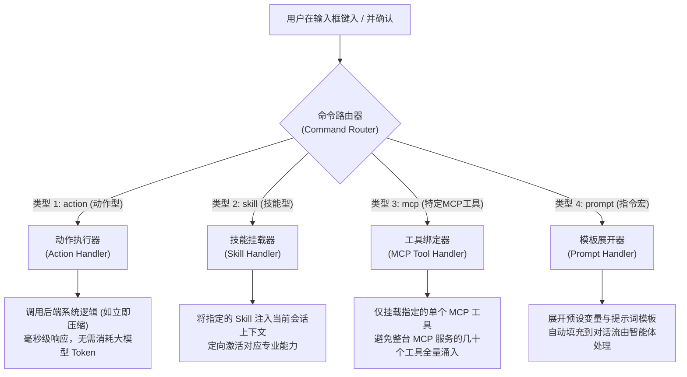
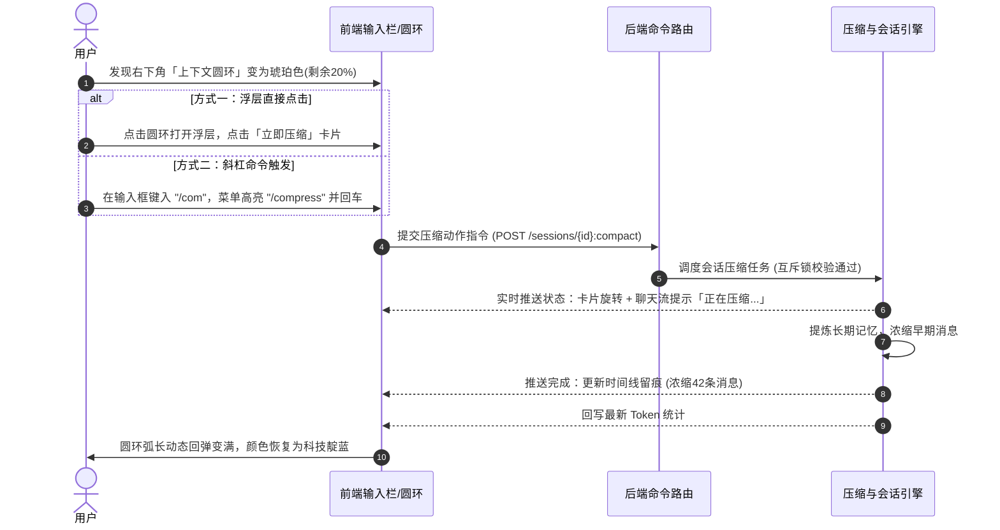

# 上下文环形可视化 · 一键压缩 · 受控斜杠命令 综合技术方案计划书

## 一、 方案总览与核心设计原则

为解决当前对话界面中「上下文感知不直观」、「长对话缺少主动干预手段」以及「工具能力散乱缺乏受控调用入口」的问题，本次技术升级围绕三大模块展开：

### 三大核心原则

1. **登录即用户，权限清晰**：系统基于既有账号与鉴权体系，所有已登录用户均可正常使用，未登录则拦截，不额外设计冗余的访客绕过逻辑。
2. **受控目录，杜绝工具泛滥**：坚决不采用全量检索模式。所有可被斜杠呼出的命令必须统一入表受控管理，彻底隔离底层内部工具（如底层文件读写、控制台命令等），确保命令列表纯净、安全。
3. **内置与自建统筹分层**：命令体系在底层数据模型中通过字段明确隔离「系统内置预设」与「用户自建拓展」，对上层界面提供一致的交互体验。

---

## 二、 模块一：上下文可视化圆环（圆圈形态）

### 1. 视觉形态升级
彻底替换当前输入框工具栏仅显示文本的简陋按钮，重构为具备动态感知能力的环形指示器（Donut Ring）：

* **尺寸与排版**：紧凑型圆环（28×28px 规格），环宽 3px，中间内嵌居中展示剩余百分比数值。
* **动效体验**：当每轮对话产生 Token 消耗或执行压缩后，圆环的弧长填充比例支持平滑过渡动画，消除数值突变带来的生硬感。

### 2. 三档健康状态变色规范
圆环边框填充颜色根据会话剩余上下文容量动态变色，给用户最直接的心理预期：

| 剩余比例区间 | 状态定义 | 视觉色彩 | 用户体验与心理预期 |
| :--- | :--- | :--- | :--- |
| **> 30%** | **健康充裕** | 科技靛蓝 / 翡翠绿 | 对话从容进行，支持大文本与深度思考 |
| **15% ～ 30%** | **容量预警** | 琥珀金黄 | 提示上下文逐步吃紧，建议精炼提问或准备压缩 |
| **< 15%** | **容量告急** | 珊瑚绯红 | 强烈视觉警示，主动引导触发压缩以防爆窗 |

### 3. 双触发交互容器
* **悬浮预览（Hover + 防抖延时关闭）**：鼠标轻触圆环时，向上弹出上下文详情浮层，移开后延时关闭。
* **点击固定（Click Pinned）**：用户点击圆环可固定浮层，便于在浮层内仔细阅读各项占用明细，或直接点击内部的操作按钮。再次点击或点击页面外部空白区域即可收起。

---

## 三、 模块二：上下文一键压缩操作卡片

### 1. 浮层卡片内的操作入口布局
在原有的上下文详情浮层（包含：系统提示词占用、工具上下文占用、历史对话占用及综合进度条）底部，新增独立的**一键压缩操作卡片**：

* **卡片展示内容**：压缩操作图标 +「立即压缩历史上下文」标题 + 简要效益说明（“自动提炼长对话要点，释放上下文空间”）。
* **操作三态流转**：
  * **就绪态**：常规边框，支持用户点击发起压缩。
  * **进行态**：卡片置灰并显示旋转加载动画，文字切换为“正在提炼并压缩记忆...”，防止用户重复点击。
  * **完成态**：短暂显示绿色成功标记与减负摘要（如“已浓缩 42 条早期消息”），随后恢复就绪态。

### 2. 压缩调度与执行控制机制
* **核心调度**：复用后端成熟的会话压缩引擎，以「即时强制触发模式」运行，确保历史对话的安全裁剪、工具调用上下文的边界保护以及长期记忆的提取落盘。
* **防并发互斥机制**：若当前会话正在进行模型流式思考，或已有压缩任务在后台执行，系统直接返回冲突提示，杜绝同一会话上下文状态发生错乱。
* **短会话智能规避**：若当前会话总消息量或 Token 占用极少，未达到压缩必要阈值，系统自动提示“当前对话极短，暂无需压缩”，避免白白浪费计算资源。
* **端到端反馈联动**：压缩完成后，界面主聊天流过程区留存压缩足迹，上下文圆环的数值与环形比例即时回弹变满。

---

## 四、 模块三：受控斜杠命令体系（Slash Commands）

### 1. 数据模型设计（命令注册表）
在业务数据库中新增统一的命令注册表，所有斜杠命令必须在此登记，绝不使用全量检索：

#### 核心字段划分与隔离逻辑

| 字段类型 | 核心字段说明 | 业务职责与隔离机制 |
| :--- | :--- | :--- |
| **基本标识** | 命令代号、UI 显示名称、描述文本 | 决定用户在输入 `/` 后匹配的关键词与菜单中看到的卡片说明 |
| **所有权与分类** | **命令来源（`origin`）** **所属用户（`owner_user_id`）** | • **系统内置 (`builtin`)**：所属用户为空，全员共享可用 • **用户自建 (`custom`)**：绑定当前用户 ID，严格按当前登录人权限隔离 |
| **路由类型** | **目标类型（`target_type`）** **关联实体（`target_id`）** | 区分该命令的具体执行去向（动作 / 技能 / MCP工具 / 指令宏）及其具体绑定的资源标识 |
| **控制与排序** | 启用状态、排序权重、配置扩展参数 | 支持后台停用/启用某项命令，决定自动补全列表中的显示先后次序 |

### 2. 命令四类路由分发架构（Command Router）

当用户通过斜杠菜单选定命令后，系统根据其 `target_type` 自动分流到对应的处理器：

#### 四类命令的精细化职责说明：
1. **系统动作型（Action）**：
   - 例如 `/compress`（立即压缩上下文）、`/clear`（清空当前会话）。
   - **特点**：属于本地系统指令，不经过大模型推理，直接触发业务逻辑，秒级生效且零 Token 成本。
2. **专业技能型（Skill）**：
   - 例如 `/code-review`（代码审查）、`/summarize`（文档提炼）。
   - **特点**：指向具体发布的技能模块，调用时将该技能专属的规则、知识库及多步执行流程定向注入。
3. **特定外部工具型（MCP）**：
   - 例如 `/web-search`（联网搜索）、`/db-query`（数据库查询）。
   - **特点**：精准映射到指定 MCP 服务下的**某一个特定工具**，而不是把服务器所有的底层接口一股脑全抛给大模型，极大降低模型幻觉与乱调率。
4. **常用指令宏（Prompt）**：
   - 例如 `/translate-en`（翻译为英文）、`/explain-simple`（通俗解释）。
   - **特点**：用户或团队自建的高频提示词模版，输入即可自动展开并带入输入内容。

### 3. 输入框自动补全菜单（UX 交互）
* **智能唤起**：在输入框内键入 `/`（处于行首或空格后）时，自动向上弹出 Radix 浮动补全面板。
* **搜索过滤**：随用户键入字符实时过滤命令名称与描述说明。
* **键盘操作**：
  * `↑` / `↓`：在命令候选项中上下切换选中态。
  * `Enter` / `Tab`：确认选择，自动将命令代号及必要占位符填入输入框，或直接触发动作。
  * `Esc`：快速关闭菜单，不破坏已键入的文字。

---

## 五、 全链路协同闭环示例

以一次长对话的上下文治理场景为例，展示三大模块的无缝协同：

---

## 六、 实施阶段与排期建议

| 阶段 | 交付目标 | 涉及领域 | 核心产出与验收指标 |
| :--- | :--- | :--- | :--- |
| **阶段一** （轻量先行） | **上下文圆环视觉升级** | 纯前端 UI | • 替换原有文字按钮为 SVG Donut Ring • 实现充裕/预警/告急三档色彩联动 • 百分比变化具备平滑过渡动画 |
| **阶段二** （能力闭环） | **一键压缩与卡片操作** | 前端浮层 + 后端动作调度 | • 上下文浮层内新增一键压缩卡片及三态反馈 • 后端落地独立的会话压缩执行接口 • 互斥锁与短会话跳过保护生效 |
| **阶段三** （体系升级） | **受控斜杠命令体系** | 数据库 + 后端路由 + 前端自动补全 | • 落地 `advisor_commands` 注册表与内置预设数据 • 后端上线 Command Router（动作/技能/MCP/Prompt） • 输入框集成受控命令搜索面板与键盘导航 |
